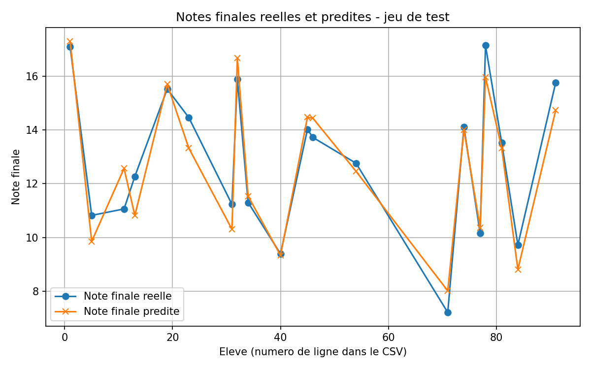

# Prédiction de la note finale — Régression linéaire multiple

Projet de Machine Learning (Atelier 3) : prédire la **note finale** d'un élève à partir de ses notes en **mathématiques**, **physique** et **français** grâce à une régression linéaire multiple (scikit-learn), avec une interface interactive **Streamlit**.

Le sujet de l'atelier décrit une boulangerie (clients, publicité, réduction → chiffre d'affaires). Le jeu de données fourni par le professeur contenant des notes d'élèves, chaque partie de l'atelier est appliquée à ce CSV :

| Sujet (boulangerie) | Ce projet (CSV fourni) |
|---------------------|------------------------|
| X1 : nombre de clients | note math |
| X2 : budget publicitaire | note physique |
| X3 : réduction (%) | note français |
| Y : chiffre d'affaires | note finale |
| Nouvelle journée (85, 45, 5) | Nouvel élève (14, 12, 15) → **13,60 / 20** |
| +10 clients | +2 points en math → **+0,64 point** |
| Variable « commandes livrées » | Variable « heures de révision » (valeurs simulées) |

## Étapes de l'atelier

| Partie | Contenu | Où le trouver |
|--------|---------|---------------|
| 1 | Préparation de l'environnement | `requirements.txt` |
| 2 | Exploration du dataset (head, dimensions, info, valeurs manquantes) | rapport, section « Partie 2 » |
| 3 | Préparation des données (X, y, découpage 80/20) | rapport, section « Partie 3 » |
| 4 | Entraînement, coefficients et constante, interprétation | rapport, section « Partie 4 » |
| 5 | Évaluation : MAE, MSE, RMSE, R² | rapport, section « Partie 5 » |
| 6 | Graphique réel vs prédit | `comparaison_notes_reelles_predites.png` |
| 7 | Nouvelle prédiction et question finale | rapport, section « Partie 7 » |
| + | Travail supplémentaire (nouvelle variable, 5 nouveaux élèves) | rapport + `donnees_enrichies_revision.csv` |

Les réponses à toutes les questions de l'atelier sont dans [`resultats_atelier3.txt`](resultats_atelier3.txt).

## Résultats

### Coefficients du modèle

| Variable | Coefficient | Interprétation (autres notes constantes) |
|----------|-------------|-------------------------------------------|
| note math | 0.3198 | +1 point → note finale +0,32 |
| note physique | 0.3561 | +1 point → note finale +0,36 |
| note français | 0.3052 | +1 point → note finale +0,31 |
| constante | 0.2717 | note prédite si les trois notes valent 0 |

Équation apprise : `note finale = 0.3198 × math + 0.3561 × physique + 0.3052 × français + 0.2717`

### Métriques d'évaluation

| Métrique | Valeur |
|----------|--------|
| MAE      | 0.668  |
| MSE      | 0.653  |
| RMSE     | 0.808  |
| R²       | 0.908  |

Le modèle explique environ **91 %** de la variation des notes finales sur le jeu de test (80 % entraînement / 20 % test, `random_state=42`).

### Travail supplémentaire

Ajout de la variable « heures de révision » et de 5 nouveaux élèves (105 lignes). Les deux modèles sont comparés sur le même dataset enrichi : le R² en validation croisée passe de 0,872 à 0,877 (+0,006). L'ajout de la variable n'améliore donc pas significativement les prédictions, car elle est déjà très liée aux trois notes. Les valeurs de cette variable sont **simulées**, puisque le CSV du professeur ne la contient pas.

| Modèle | MAE | RMSE | R² (test) | R² (validation croisée) |
|--------|-----|------|-----------|-------------------------|
| Ancien (3 variables) | 0.903 | 1.014 | 0.837 | 0.872 |
| Nouveau (4 variables) | 0.870 | 0.990 | 0.845 | 0.877 |

### Graphique comparatif



## Structure du projet

```
├── app.py                                    # Interface Streamlit
├── regression_notes.py                       # Programme complet de l'atelier (parties 2 à 7 + travail supplémentaire)
├── donnees_regression_lineaire_multiple.csv  # Dataset fourni par le professeur (100 élèves, 4 colonnes)
├── donnees_enrichies_revision.csv            # Dataset enrichi généré (travail supplémentaire)
├── resultats_atelier3.txt                    # Rapport : réponses, coefficients, métriques, interprétation
├── comparaison_notes_reelles_predites.png    # Graphique généré par regression_notes.py
└── requirements.txt
```

Le sujet de l'atelier (PDF du professeur) n'est pas inclus dans le dépôt.

## Installation

```bash
git clone https://github.com/wissalwissal202008/prediction-notes-regression.git
cd prediction-notes-regression
pip install -r requirements.txt
```

## Utilisation

Générer le rapport et le graphique :

```bash
python regression_notes.py
```

Lancer l'application web :

```bash
streamlit run app.py
```

L'application permet :
- d'explorer les données ;
- de voir les métriques, le graphique et les coefficients du modèle ;
- de saisir les notes d'un élève pour obtenir sa note finale prédite ;
- de comparer l'ancien et le nouveau modèle (travail supplémentaire).

La section « Travail supplémentaire » utilise `donnees_enrichies_revision.csv`. Ce fichier est fourni dans le dépôt et `python regression_notes.py` le recrée.

## Technologies

Python · pandas · NumPy · scikit-learn · Matplotlib · Streamlit
